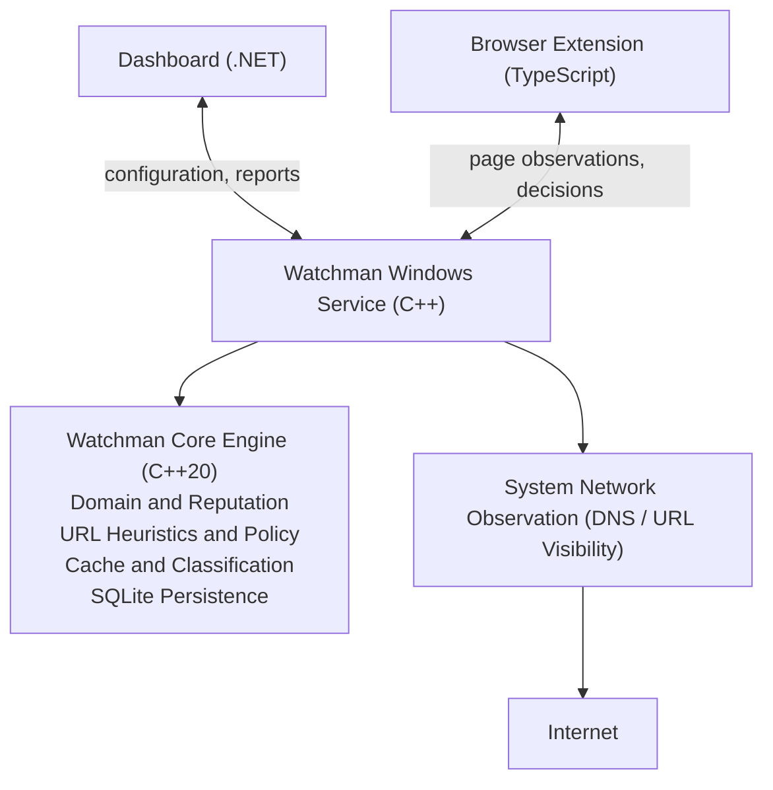
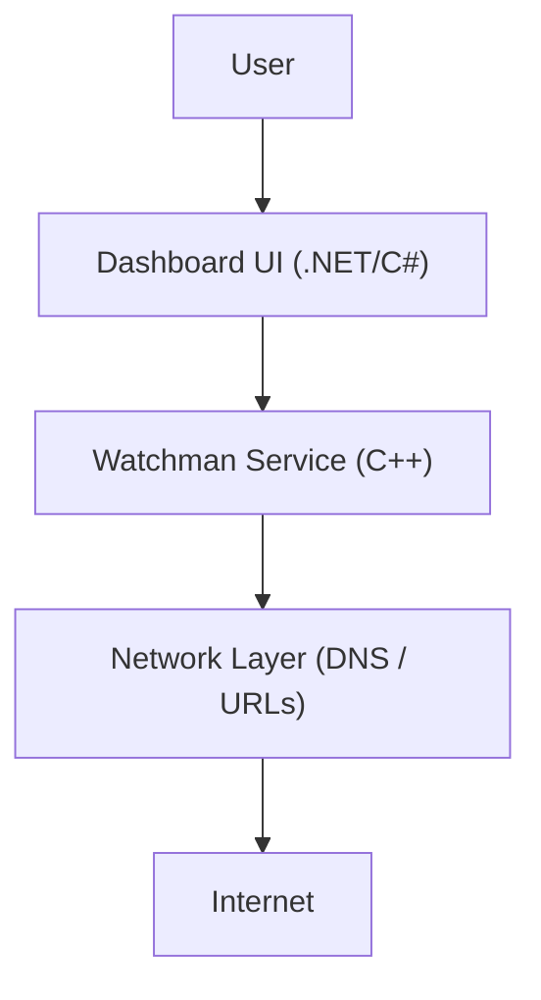
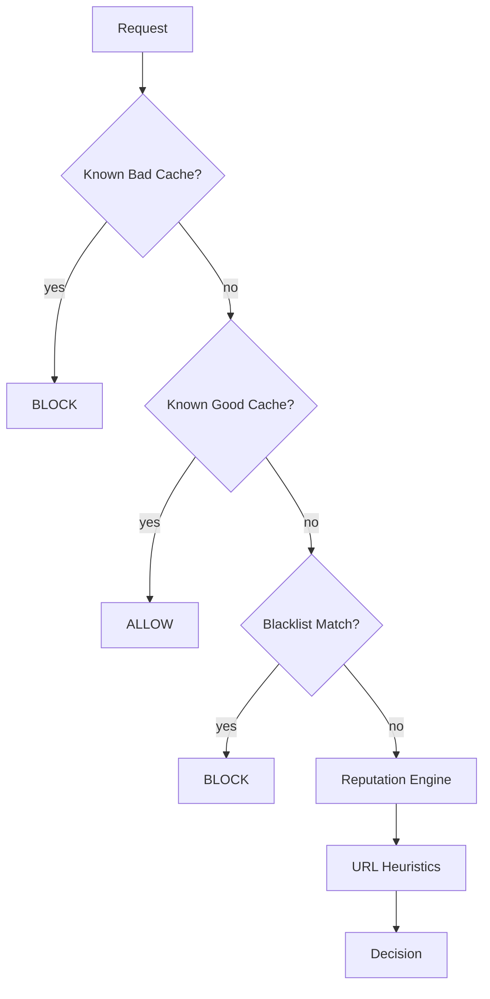
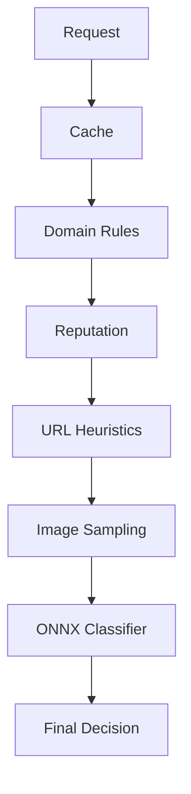
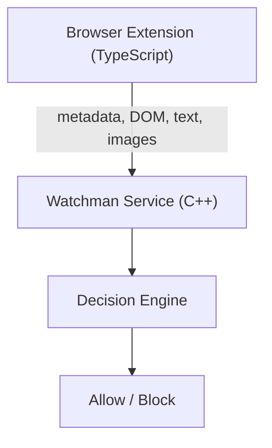
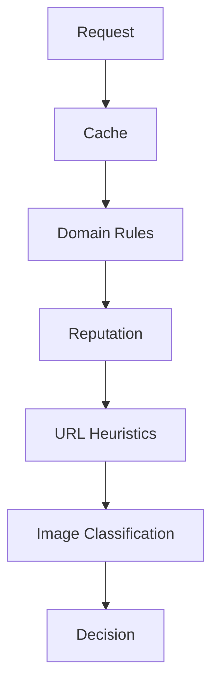
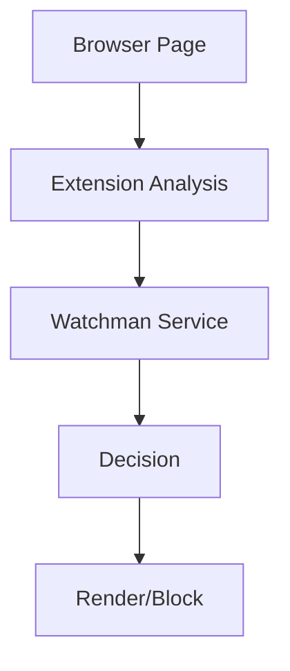

# Watchman - Architecture & Development Roadmap ([BCDD](https://github.com/adadevoh/bcdd/blob/main/bcdd.md))

## Product Vision

Watchman is a local-first, system-wide Windows content filtering platform whose initial purpose is to help users prevent access to pornographic content across browsers and desktop applications.

The product is built using [Behaviour Contract Driven Development (BCDD)](https://github.com/adadevoh/bcdd/blob/main/bcdd.md). The design document defines the product, behaviour catalogue, guardrails, architecture, deployment strategy, and iteration plan. Observable behaviour is described in Behaviour Contracts under `bc/`.

---

# Product Scope

Watchman will evolve through three iterations:

1. Domain and reputation-based blocking
2. AI-assisted image classification
3. Browser-aware content inspection

The system must always prefer the cheapest successful classification path.

The image classifier is a last resort.

---

# Product Invariants

- The system is deny-by-confidence, not deny-by-guess.
- Known decisions must be cached.
- Classification decisions must be explainable.
- A cache hit must always be cheaper than reclassification.
- User overrides always take precedence over automatic classification.
- System-wide protection is the primary product.
- Browser integrations are enhancements, not dependencies.
- Classification logic must remain reusable regardless of integration surface.

---

# Recommended Tech Stack

## Core Engine

- C++20
- SQLite
- ONNX Runtime (Iteration 2)
- OpenCV (Iteration 2)
- spdlog
- Boost.Asio (`boost::asio`)
- nlohmann/json

The core engine is Watchman's primary intelligence layer. It is responsible for:

- Domain filtering
- Reputation tracking
- URL heuristics
- Cache management
- Content classification
- Policy evaluation
- Persistence
- Observability and diagnostics

The core engine must remain independent of the dashboard and any specific integration surface.

## Windows Service

- C++20

The service hosts the core engine and provides always-running, system-wide protection. It remains the decision authority for requests from supported system and browser integrations.

## Desktop Dashboard

- C#
- .NET

The dashboard provides user-facing configuration and visibility:

- Settings management
- Statistics
- Classification history
- Domain allow/block management
- Reputation management
- Diagnostic tools

The dashboard is separate from the filtering engine to support faster UI development, strong Windows integration, easier maintenance, and the use of existing .NET expertise.

## Browser Extension (Iteration 3)

- TypeScript
- Chrome Extension APIs
- Edge Extension APIs

The extension is an observation layer, not the source of truth. It provides browser content visibility while the Watchman Service remains the decision engine. Its responsibilities include:

- DOM inspection
- Metadata extraction
- Page title extraction
- Visible text extraction
- Visible image extraction
- Rendering block pages

---

# Target Product Components

Watchman is composed of four cooperating components:

1. **Watchman Core Engine (C++)** — reusable classification and policy intelligence.
2. **Watchman Windows Service (C++)** — always-running host for system-wide protection and the core engine.
3. **Watchman Dashboard (C#/.NET)** — configuration, reporting, and diagnostics.
4. **Watchman Browser Extension (TypeScript)** — browser visibility and page-level analysis.

The dashboard and extension communicate with the service; neither becomes an alternate source of classification decisions.

# High-Level Architecture



---


# Architectural Diagrams

## System Context Diagram



## Iteration 1 Decision Pipeline



## Iteration 2 Classification Pipeline



## Iteration 3 Browser Integration




# Behaviour Catalogue

## Iteration 1

### BH-DOMAIN-FILTER

System blocks known adult domains.

BC:

```text
bc/domain-filter/domain-filter.bc.md
```

Status:

```text
Planned
```

### BH-REPUTATION

System stores and applies reputation information to domains.

BC:

```text
bc/reputation/reputation.bc.md
```

Status:

```text
Planned
```

### BH-URL-HEURISTICS

System evaluates unknown URLs using configurable heuristics.

BC:

```text
bc/url-heuristics/url-heuristics.bc.md
```

Status:

```text
Planned
```

### BH-CACHE

System caches known-good and known-bad decisions.

BC:

```text
bc/cache/cache.bc.md
```

Status:

```text
Planned
```

---

## Iteration 2

### BH-IMAGE-CLASSIFICATION

System classifies visual content on unknown sites.

BC:

```text
bc/image-classification/image-classification.bc.md
```

Status:

```text
Planned
```

---

## Iteration 3

### BH-BROWSER-INTEGRATION

System gains browser-level visibility and filtering.

BC:

```text
bc/browser-integration/browser-integration.bc.md
```

Status:

```text
Planned
```

---

# Iteration Plan

## Iteration 1

### Goal

Deliver a functional system-wide blocker that requires no AI.

### What Users Gain

Users can install Watchman and immediately receive protection against:

- Known adult domains
- Known adult DNS targets
- Suspicious adult URLs

Coverage includes:

- Chrome
- Edge
- Firefox
- Reddit desktop app
- Discord web requests
- Electron applications

### What Must Be Implemented

#### Domain Engine

Responsibilities:

- Block known domains
- Match wildcard domains
- Support user-maintained allow/block lists

Examples:

```text
*.example-adult-site.com
*.adult-cdn.net
```

#### Reputation Engine

Responsibilities:

- Persist domain reputation
- Track confidence
- Record first/last-seen data

Example:

```text
adultcams.example
score = 95
classification = adult
```

#### URL Heuristics Engine

Responsibilities:

- Analyze domain names
- Analyze paths
- Analyze query strings
- Calculate risk scores

Example:

```text
free-sex-videos.com/live-cams
```

#### Cache Manager

Responsibilities:

- Known-good cache
- Known-bad cache
- TTL management

Goal:

```text
O(1) lookup before reclassification
```

#### SQLite Repository

Stores:

- Domain decisions
- Reputation data
- User overrides
- Configuration
- Statistics

### Success Metric

Majority of blocking decisions occur without expensive analysis.

---

## Iteration 2

### Goal

Detect pornography on domains that are not already known.

### What Users Gain

Users are protected from:

- Newly created domains
- Unknown image hosts
- Previously unseen adult websites

### What Must Be Implemented

#### Image Classification Engine

Responsibilities:

- Sample images
- Preprocess images
- Run ONNX models
- Produce confidence values

Input:

```text
Image
```

Output:

```text
Adult probability
```

#### Classification Pipeline



### Success Metric

Previously unseen adult content can be identified with high confidence.

---

## Iteration 3

### Goal

Add browser-level content awareness.

### What Users Gain

The system can distinguish between:

```text
reddit.com/r/programming
```

and

```text
reddit.com/r/nsfw
```

without blocking all of Reddit.

### What Must Be Implemented

#### Browser Extension

Responsibilities:

- Read DOM content
- Read page metadata
- Extract page titles and visible text
- Inspect visible images
- Replace pages with block screens

#### Service Integration

Extension becomes an observation layer.

The C++ service remains the decision engine.

Flow:



### Success Metric

User-generated-content platforms can be filtered at page level rather than domain level.

---

# Long-Term Extensibility (Not Current Scope)

Watchman's long-term architecture is intended to support reusable content classification beyond pornography filtering. Potential future categories include:

- Gambling
- Malware
- Violence
- Drugs
- Social media
- Custom organizational policies

These categories are future possibilities, not current product requirements or shipped behaviours. Each category must be added to the product scope and behaviour catalogue and specified by a Behaviour Contract before implementation.

# Deployment Strategy

## Development

Local workstation.

## Packaging

Windows installer.

## Runtime

Windows Service started automatically.

## Shipped Definition

A behaviour is shipped only when:

- Its BC exists.
- Its BC is marked done.
- No unimplemented signal remains.
- Associated tests pass.
- Design document and BC agree.

---

# Unimplemented Signal

All scaffolded but unfinished behaviour must return:

```text
NOT_IMPLEMENTED
```

or the platform-specific equivalent.

The signal must never be mistaken for a successful classification decision.
